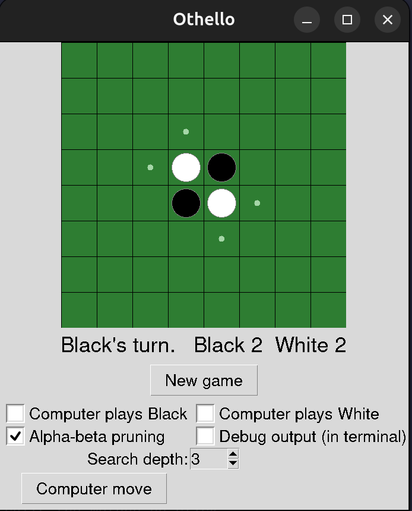

# Othello AI

Othello with a computer opponent that looks ahead using **minimax search with alpha-beta pruning**. Play against it, have it play itself, or turn pruning on and off to see how many fewer board states it has to examine.



## Running it

Requires Python 3 with Tkinter (included with most Python installs; on Debian/Ubuntu: `sudo apt install python3-tk`).

```bash
python3 gui.py
```

Black moves first. Small dots mark the legal moves for whoever's turn it is; click one to play.

### Controls

| Control | What it does |
|---|---|
| **Computer plays Black / White** | Hand either color (or both) to the AI |
| **Computer move** | Have the AI make one move for whoever's turn it is |
| **Search depth** | How many moves ahead the AI looks (1–8) |
| **Alpha-beta pruning** | Turn pruning on or off. The "States examined" count shows the difference |
| **Debug output** | Print every searched line of play and its score to the terminal |

## How the AI works

**Search:** `minimax()` in `othello.py` tries every legal move, then every reply, down to the chosen depth. Black maximizes the score and White minimizes it. If a player has no legal move, they pass and the search continues with the other player.

**Alpha-beta pruning:** while searching, the AI tracks the best score each side is already guaranteed (`alpha` for Black, `beta` for White). As soon as a branch can't beat a guarantee the other side already has, the rest of that branch is skipped. It picks the same move as plain minimax while examining far fewer boards.

**Evaluation:** when the search stops, `evaluate()` scores the board from Black's point of view:

- **Position:** a weight table values each square. Corners are worth 100 because they can never be flipped. The squares diagonally next to a corner are worth −50 because taking one usually gives the opponent that corner. Edges are mildly good, and the center is nearly neutral.
- **Mobility:** each extra legal move a player has over the opponent adds 5 points, since running the opponent out of moves is how Othello is won.
- **Game over:** a finished game scores 10,000 × the disc difference, so an actual win or loss always outweighs any positional score.

## Files

- `othello.py`: board rules, move generation, evaluation, and the minimax search
- `gui.py`: the Tkinter window

Author: Braydon Callender
